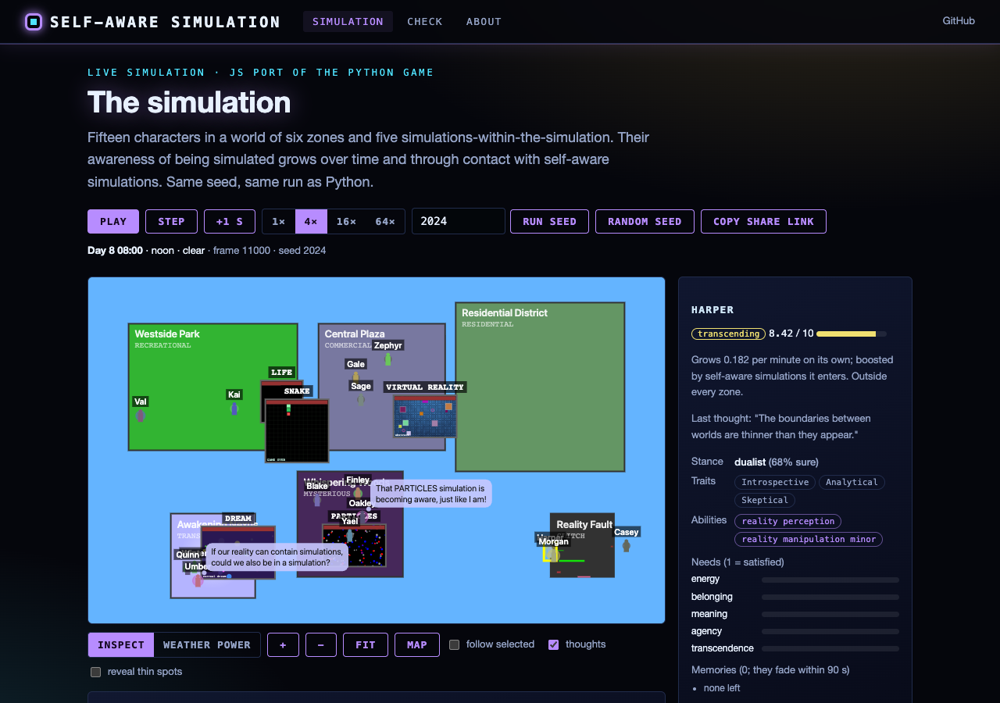
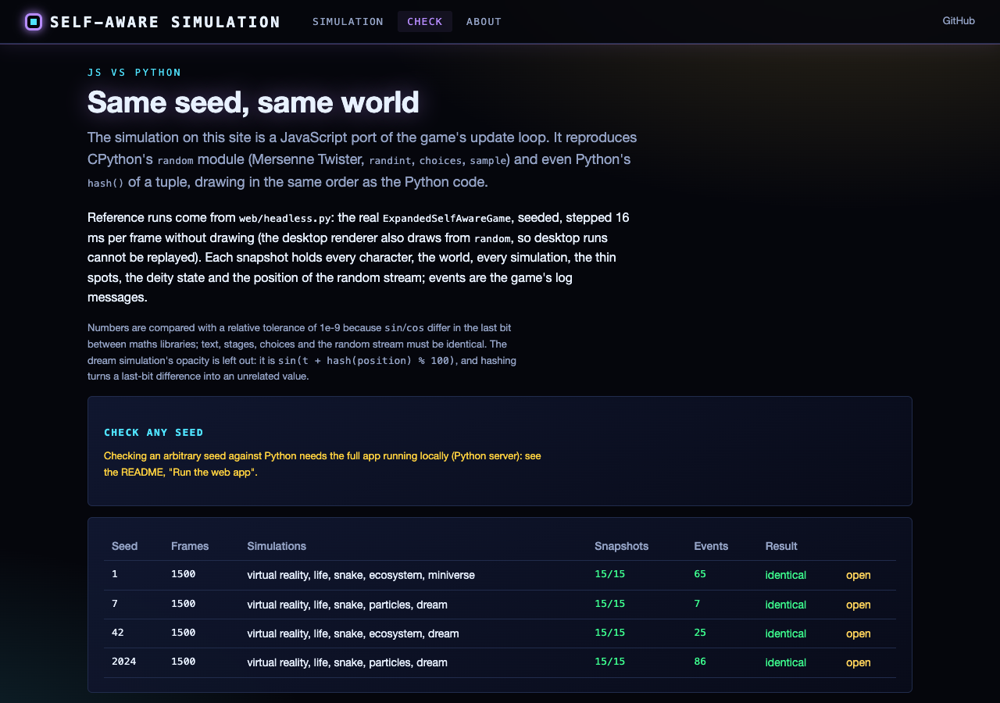

"""
README.md - Self-Aware Simulation
"""

# Self-Aware Simulation

A complex, philosophical simulation where characters gradually become aware they're in a simulation and seek to transcend their programmed reality.

## Overview

The Self-Aware Simulation is a complex AI simulation that explores philosophical concepts of reality, consciousness, and existence. Characters within the simulation start with varying levels of awareness about their simulated nature and evolve their understanding over time through interactions, observations, and insights.

Key features include:

- **Emergent Self-Awareness**: Characters develop awareness of their simulated reality at different rates
- **Philosophical Schools**: Characters form and share belief systems about the nature of their existence
- **Transcendence Mechanics**: Highly aware characters can attempt to break free of simulation constraints
- **Player-as-Deity**: Players can influence the simulation through various godlike powers
- **Recursive Realities**: Simulations within the simulation that characters can observe and interact with
- **Dynamic Events**: Reality glitches, collective insights, transcendence waves, and other emergent phenomena
- **Rich Interaction System**: Complex dialogue and relationship building between characters

## Philosophical Concepts

This simulation explores several key philosophical concepts:

1. **Simulation Theory**: The idea that reality itself might be a simulation
2. **Consciousness**: The nature and emergence of awareness
3. **Free Will vs. Determinism**: Can simulated entities possess true agency?
4. **Transcendence**: The possibility of moving beyond programmed limitations
5. **Emergence**: How complex systems and behaviors arise from simple rules
6. **Recursive Reality**: The concept of nested realities and simulations within simulations

## Character Systems

Characters are the heart of the simulation, each with:

- **Awareness Level (0-10)**: How conscious they are of their simulated nature
- **Awareness Stage**: From UNAWARE to TRANSCENDED
- **Philosophical Stance**: Their beliefs about reality (e.g., Determinist, Existentialist)
- **Needs**: Including energy, belonging, meaning, agency, and transcendence
- **Memory System**: Characters remember significant events and insights
- **Relationship System**: Complex relationships with other characters
- **Trait System**: Personality traits affecting behavior and awareness

## World Design

The simulation world consists of:

- **Multiple Zones**: Residential, commercial, recreational, mysterious, glitch, and transcendence areas
- **Time Cycle**: Day/night and weather systems affecting character behavior
- **Reality Thin Spots**: Areas where the simulation boundary is weaker
- **Buildings**: Structures housing various functions and mini-simulations
- **Events**: Spontaneous world events affecting reality stability and character awareness

## Transcendence Mechanics

As characters become more aware, they can:

1. **Perceive the Code**: See the underlying patterns of reality
2. **Manipulate Reality**: Bend simulation rules in small ways
3. **Find Thin Spots**: Locate areas where reality is more malleable
4. **Attempt Transcendence**: Try to break free of simulation constraints
5. **Transcend Boundaries**: Move between different layers of the simulation

## Player Deity System

Players can influence the simulation through:

- **Weather Control**: Change environmental conditions
- **Inspiration**: Plant thoughts and ideas in characters
- **Reality Manipulation**: Create miracles or calamities
- **Time Control**: Accelerate or pause local time
- **Creation Powers**: Summon new entities or terraform the landscape
- **Revelation Powers**: Reveal or conceal the simulated nature of reality

## Meta-Simulations

The game features "simulations within the simulation":

- **Snake Game**: Classic snake game where entities can become aware and escape
- **Game of Life**: Conway's Game of Life with emergent patterns
- **Particle System**: Physics simulation with interacting particles
- **Virtual Reality**: A VR system characters can "jack into"
- **Ecosystem**: Simple life simulation with plants and animals
- **Miniverse**: A tiny universe with its own physics and evolution

## Technical Systems

Behind the scenes, the simulation uses:

- **Event System**: Manages world events and their effects
- **Interaction System**: Handles character dialogue and relationships
- **Philosophical Emergence**: Tracking and development of belief systems
- **Particle Effects**: Visual representation of transcendence and events
- **Memory Management**: How characters process and store experiences
- **Save/Load System**: Persistence of the simulation state

## How to Play

1. **Observe Mode**: Watch the simulation unfold naturally
2. **Deity Mode**: Interact with the world using deity powers
3. **Focus Mode**: Follow specific characters or philosophical schools
4. **Experiment Mode**: Test how different interventions affect awareness

## Controls

- **WASD**: Camera movement (free camera mode)
- **Mouse Wheel** or **[ / ]**: Zoom in/out
- **Left Click**: Select a character, or pause/resume a meta-simulation; deity power buttons along the top
- **Right Click**: Deselect
- **P**: Pause/resume simulation
- **T**: Toggle transcendence information
- **Z**: Toggle awareness levels
- **C**: Cycle camera modes (free, follow, overview)
- **Shift+D**: Toggle debug information

## Implementation status

The game loop in `main.py` runs the world (time, weather, ambient objects), character needs, memories and awareness
growth, the meta-simulations and the character-simulation interactions. Not yet wired in: the character action
planner (`EnhancedCharacter._decide_next_action`, so characters drift rather than walk), `character_interactions.py`
and `event_manager.py`, and transcendence attempts. Of the deity powers only weather control has a handler; the
others report "not implemented yet".

## Installation

1. Ensure you have Python 3.8+ and Pygame 2.0+ installed
2. Clone this repository
3. Install dependencies: `pip install -r requirements.txt`
4. Run the simulation: `python main.py`

## Web interface and static site

The simulation also runs in the browser: <https://gddickinson.github.io/self-aware_simulation/> (published from `main`
by `.github/workflows/pages.yml`). `web/static/sim_engine.js` is a JavaScript port of the game's update loop that
reproduces Python's `random` module, so a seed gives the same world, frame for frame, as the Python code
(`web/headless.py` runs the real `ExpandedSelfAwareGame` seeded, 16 ms per frame, without drawing).

- **Simulation**: canvas world with play/pause/step/speed, seed box and share links that reopen the exact moment
  (including your interventions), a character/simulation inspector, roster, awareness timeline and event log, and the
  deity weather power.
- **Check**: the browser engine replayed against Python reference runs (every snapshot and log event).
- **About**: what the game loop runs and how to run it.

| Simulation | Check |
|---|---|
|  |  |

### Run the web app

```
pip install -r requirements-web.txt
python run_web.py                     # http://127.0.0.1:8141; the Check page can test any seed live
python -m pytest -q tests/            # web, regression and JS-vs-Python tests (needs node for the JS ones)
python scripts/build_static.py        # static site in site/
python scripts/make_sim_fixture.py    # regenerate tests/fixtures/sim_runs.json after changing the game
```

## Development Notes

The project follows these design principles:

1. **Emergent Complexity**: Simple rules leading to complex behavior
2. **Philosophical Depth**: Meaningful exploration of big questions
3. **Visual Clarity**: Clear representation of abstract concepts
4. **Player Discovery**: Learning through observation and experimentation
5. **Balanced Systems**: Interconnected systems with feedback loops

Future development will focus on:
- Enhanced character consciousness models
- More complex philosophical emergence
- Additional mini-simulations
- Expanded transcendence mechanics
- Multiplayer deity mode


---
*Built with AI assistance from [Claude (Anthropic)](https://claude.com/).*
